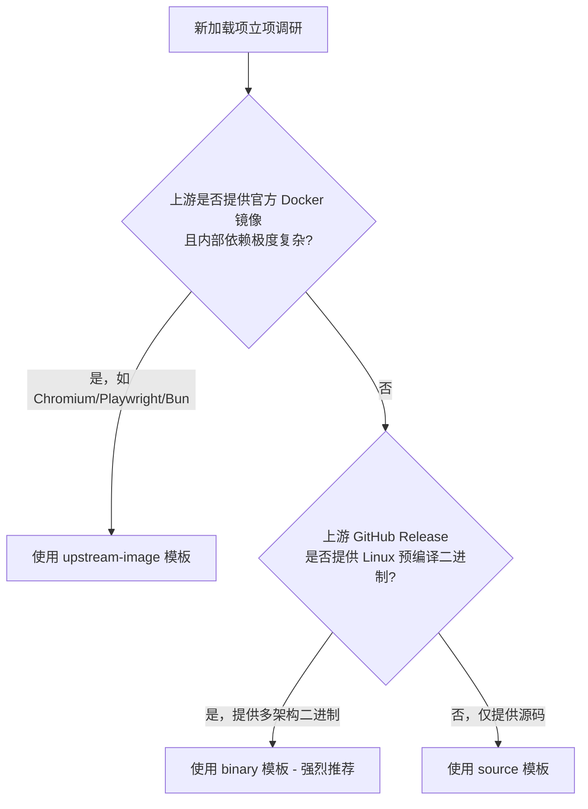

# Home Assistant 加载项脚手架模板指南

> 本目录维护 3 套经过生产检验的加载项骨架模板，涵盖不同的上游软件分发形态。
> 新建加载项时，请先依据下表选型，然后复制对应模板目录开始开发。

---

## 一、 模板架构选型矩阵



| 模板路径 | 架构策略 | 适用场景与代表 | 核心组件与机制 |
|---|---|---|---|
| [binary/](binary/) | **预编译二进制下载型**<br>*(推荐首选)* | • 上游发版提供静态二进制（GoReleaser 产物等）<br>• 代表：`lucky`, `cliproxyapi`, `workbuddy2api`, `filebrowser` | • `debian-base:9.3.0` + S6 overlay<br>• 内置 `TARGETARCH` 架构映射与 `--retry 3 --retry-all-errors`<br>• `00-init.sh` 软链接接管与 `/run/<slug>-initialized` 串行等待 |
| [upstream-image/](upstream-image/) | **官方镜像包装型**<br>*(复杂应用专属)* | • 上游镜像内置复杂专有环境（如 Headless 浏览器、高版本运行时）<br>• 代表：`flaresolverr`, `mcphub`, `trawl` | • **无 S6 overlay**（避免与父镜像环境冲突）<br>• 采用 `dumb-init` 规范管理进程生命周期<br>• 注入 `ha-entrypoint.sh`：自动创建持久化目录并解析 options 转 env |
| [source/](source/) | **多阶段源码构建型**<br>*(纯源码项目)* | • 上游仅提供源码，需自主编译打包<br>• 代表：`baihu-panel`, `qinglong`, `uptime-kuma`, `qdtoday` | • Stage 1: 专用 builder（内置多代理 `GOPROXY="...,direct"` 容灾）<br>• Stage 2: `debian-base` 纯净运行时 + S6 overlay<br>• 彻底规避 C-extensions 运行时 libc 版本冲突 |

---

## 二、 快速上手命令

### 步骤 1：复制目标模板
根据选型复制对应模板至新加载项目录（以 `binary` 模板为例）：

```bash
# 场景 A: 预编译二进制型 (推荐)
cp -r .github/templates/binary/ <addon-slug>/

# 场景 B: 官方镜像包装型
cp -r .github/templates/upstream-image/ <addon-slug>/

# 场景 C: 多阶段源码构建型
cp -r .github/templates/source/ <addon-slug>/
```

### 步骤 2：全局替换占位符
将目录内所有文件的占位符 `ADDON_SLUG` 替换为实际的 slug：
- Linux/macOS:
  ```bash
  find <addon-slug>/ -type f -exec sed -i 's/ADDON_SLUG/<addon-slug>/g' {} +
  ```
- Windows PowerShell:
  ```powershell
  Get-ChildItem -Path <addon-slug> -Recurse -File | ForEach-Object {
      (Get-Content $_.FullName) -replace 'ADDON_SLUG', '<addon-slug>' | Set-Content $_.FullName
  }
  ```

### 步骤 3：调整服务目录名称（针对 binary 与 source 模板）
由于 S6 服务目录名必须与 slug 严格一致，需将 `ADDON_SLUG` 目录重命名：
```bash
mv <addon-slug>/rootfs/etc/s6-overlay/s6-rc.d/ADDON_SLUG    <addon-slug>/rootfs/etc/s6-overlay/s6-rc.d/<addon-slug>/
```

### 步骤 4：填充配置并本地验证
1. 完善 `<addon-slug>/config.yaml`（端口、描述、webui）；
2. 完善 `<addon-slug>/version.yaml`（上游仓库、提取策略、构建参数）；
3. 执行最低成本本地构建验证：
   ```bash
   docker buildx build --platform linux/amd64        --build-arg APP_VERSION=1.0.0        -f <addon-slug>/Dockerfile <addon-slug> --load --tag local/<addon-slug>:check
   ```
